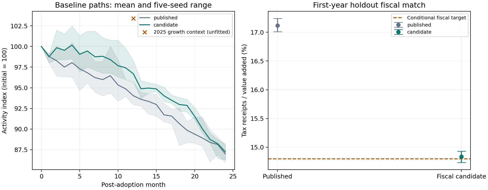

# Peru calibration and pilot — first completed study

© 2026 Joseph Pozsgai-Alvarez. Source engine: Antarkya 3.0.0, commit `f90540ffe1d1bee659d43d1c46ab72874447b3fe`. Study date: 24 November 2026.

**Decision: do not promote the fiscal candidate to production defaults.** The first calibration attempt and exploratory pilot are complete. A narrow fiscal ratio can be matched, but economic baseline behavior and national measurement coverage are insufficient for an empirically calibrated Peru simulation. Passing engineering tests did not establish that realism.

## Design and calibration

The study contains **74 trajectories and 1,752 post-adoption simulated months**, each with exactly 1,000 agents: 18 training trajectories across nine fiscal parameter pairs, 40 held-out policy trajectories, ten one-at-a-time sensitivities, two 120-month diagnostics and four additional-initial-society trajectories. Two training event seeds and five disjoint holdout event seeds were used. Four scenarios were baseline, education, anti-corruption body, and both reforms; each selected tool began at 70% mobilization. The main pilot ran for 24 months. Within a parameter/initial-society combination, every counterfactual begins from the identical reconstructed state. The preliminary unmodified diagnostic was inspected before this protocol; this is not a preregistered study.

The fiscal target is **14.8%**, from BCRP's fixed February 2026 report for 2025. Its non-tax and nonfinancial-spending ratios are 4.2% and 20.0%; the rolling MEF alternative reports 14.9%, 4.2% and 20.1%. These vintages are preserved separately. The model's simplified private-value-added levy is a lumped fiscal proxy, not Peru's tax code. A national mix of tax instruments is not separately represented.

The minimum training error selects `taxAssessmentRate=0.19` and `backgroundCompliance=0.85`. Its training tax ratio is **14.79%**. This does not identify a real statutory rate or compliance estimate: two free coefficients and an unmapped taxable base cannot be identified by one fiscal moment. No macro growth rate, corruption prevalence, or policy effect was optimized.

## Held-out baselines

| Model | Year-one tax share: mean [seed range] | Year-one activity change: mean [seed range] | Month-24 activity index: mean [seed range] |
| --- | --- | --- | --- |
| published | 17.12% [17.01%, 17.24%] | -5.96% [-7.06%, -4.33%] | 87.00 [85.96, 87.99]  |
| candidate | 14.84% [14.74%, 14.93%] | -3.31% [-4.29%, -1.73%] | 87.26 [86.28, 88.23]  |



The baseline contracts across the five principal event-seed holdouts. In the published unmodified 120-month diagnostic, the activity index ends at **53.64** and productive capacity at **247.75**. In the fiscal candidate's 120-month diagnostic, those values are **54.00** and **252.86**. This is a model diagnostic, not a Peru forecast. The unfitted 2025 real-total-growth context is 3.4%; one observed annual growth rate does not define a perpetual future growth requirement. The decline nevertheless flags a baseline that needs economic investigation before policy conclusions.

## Paired policy pilot

The following are reform-minus-baseline differences in **trailing-12-month corrupt encounters per 100 encounters at month 24**. Negative values mean fewer qualifying corrupt encounters inside the model. Each range is the minimum/maximum across five matched event seeds; it is not a confidence interval. Tax concealment and private diversion remain outside this legacy encounter estimand and remain in their separate act records.

| Parameter set | Scenario | Mean difference (percentage points) | Five-seed range |
| --- | --- | --- | --- |
| published | education | -0.95 | [-1.31, -0.48]  |
| published | aca | -0.05 | [-0.11, -0.01]  |
| published | combined | -0.93 | [-1.40, -0.43]  |
| candidate | education | -0.73 | [-1.29, -0.39]  |
| candidate | aca | 0.16 | [-0.03, 0.53]  |
| candidate | combined | -0.46 | [-0.78, -0.18]  |

These are exploratory conditional effects, not observed reform effectiveness. The small pilot cannot establish a reliable policy ranking. Additional initial-society checks use two different initialization seeds and paired baseline/combined scenarios; their results are retained separately. This exposes some initialization sensitivity, without treating the full synthetic population composition as empirically estimated.

## Sensitivity and interpretation

| Parameter | Trial value | Month-24 baseline activity index | Year-one tax ratio |
| --- | --- | --- | --- |
| annualDepreciation | 0.03 | 93.81 | 14.72% |
| annualDepreciation | 0.12 | 80.15 | 14.75% |
| capitalOutputYears | 2 | 86.95 | 14.73% |
| capitalOutputYears | 5 | 86.25 | 14.73% |
| maintenanceShare | 0.01 | 86.76 | 14.82% |
| maintenanceShare | 0.05 | 86.79 | 14.77% |
| damageRate | 0 | 86.69 | 14.75% |
| damageRate | 0.02 | 86.45 | 14.68% |
| exportDemand | 30 | 87.10 | 14.74% |
| exportDemand | 120 | 84.84 | 14.72% |

These ten runs change one parameter at a time around the fiscal candidate, using one holdout event seed and reconstructing the initial year under that variant. Their contrasts therefore combine changed starting conditions and changed post-adoption dynamics. They are diagnostics, not controlled mediation estimates or global uncertainty analysis.

## Evidence and measurement gaps

BCRP's 2025 private fixed-investment share is 16.6% of nominal GDP. The model records funded imported equipment orders and completed installation separately; it omits background investment and has fixed reference prices. Neither model series is a fully matched national investment target. The model's generic business capability utilization likewise is not a manufacturing-weighted survey estimate.

The verified 2023 Enterprise Survey indicators are 12.3% of senior management time on regulation, 118.3 days for an operating license, 7.6% bribery incidence, and 22.1% tax-contact prevalence. The survey concerns eligible formal firms with at least five employees. The simulation's 210 business-role people and 24 business organizations do not supply that sampling frame. Generic contacts and permit tasks lack the necessary subtype, exposure/recall and eligibility variables. These four values were **not** fitted to incompatible model rates. Capacity-utilization metadata were located, but a weighted population mean remains unextracted; unknown and structurally missing responses are not zero.

The real GDP-per-capita context is 17,633.3 soles at 2007 prices in 2025. It was not converted into household incomes or normalized resource units. Country-governance profiles, represented-output shares, national expansion weights, capital/depreciation priors and behavioral learning parameters remain unvalidated. Every C01–C16 and P01–P20 register entry is retained with its current status in `calibration-register.json`.

## Engineering verification and reproduction

No production runtime or browser default was changed. The 18 original training trajectories were deterministically replayed to archive their monthly observations, and their fiscal ratios matched to 1e-12; those replays are not counted as additional independent study trajectories. Research variants replace only the AST-located frozen parameter initializer in isolated CommonJS module instances; original source hashes and the transformed hybrid hash are recorded. Two harness checks pass: exact default replay of initial society and six-month full state/view, and parameter bounds/isolation. Source hashes match the pinned release. All study trajectories execute the engine's resource/time feasibility assertions; matched initial-state hashes and trajectory counts are checked again during analysis. Maximum observed cash-total drift relative to the first recorded month in the retained study records is 3.3e-06 normalized units. The sampled Linux process runtime/RSS is retained in the manifest; it is not an Android measurement.

Use a full Git checkout with the pinned ancestor present, then run from the repository root:

```sh
npm ci --ignore-scripts --no-audit --no-fund
node --test research/peru-pilot/engine.test.cjs
node research/peru-pilot/observe.cjs
node research/peru-pilot/pilot.cjs
node research/peru-pilot/initial-robustness.cjs
node research/peru-pilot/archive-training.cjs
python research/peru-pilot/analyze.py
```

Python needs matplotlib for the figure (`python -m pip install -r research/peru-pilot/requirements.txt`). Algorithms, protocol, seeds, grid, complete monthly records and evidence metadata are included. Raw JSON records are distributed as deterministic gzip files; CSV and summary JSON provide direct access. Timing and memory can vary across machines.

## Required next changes

First reconcile represented and omitted production/investment, financing, trade and household/government cash circulation with consistent output weights. Add survey-matched firm sampling and transaction records before estimating contact, delay or bribery parameters. Then specify sourced parameter bounds, refit multiple independent moments and test against reserved data. National governance mappings and Android performance remain separate requirements. The current fiscal candidate is retained for reproducibility and rejected as a production calibration.

## Primary sources

- [BCRP-FISCAL-2025: Informe Macroeconómico IV trimestre 2025, No.13, Table 11](https://www.bcrp.gob.pe/docs/Publicaciones/Notas-Estudios/2026/nota-de-estudios-13-2026.pdf) — accessed 24 November 2026.
- [BCRP-MEF-ALTERNATIVE: Balance del Sector Público](https://www.mef.gob.pe/es/informacion-del-mef-art-26/balance-del-sector-publico) — accessed 24 November 2026.
- [BCRP-GROWTH: Real total GDP growth](https://estadisticas.bcrp.gob.pe/estadisticas/series/anuales/resultados/PM04863AA/html) — accessed 24 November 2026.
- [BCRP-REAL-PER-CAPITA: Real GDP per capita](https://estadisticas.bcrp.gob.pe/estadisticas/series/anuales/resultados/PM04862AA/html) — accessed 24 November 2026.
- [BCRP-INVESTMENT: Private gross fixed investment, nominal GDP expenditure structure](https://estadisticas.bcrp.gob.pe/estadisticas/series/anuales/resultados/PM04962AA/html) — accessed 24 November 2026.
- [WBES-2023: Peru 2023 Country Profile, pages 12–13](https://www.enterprisesurveys.org/content/dam/enterprisesurveys/documents/country/Peru-2023.pdf) — accessed 24 November 2026.
- [WBES-CAPACITY-METADATA: f1: Last FY capacity utilization of establishment](https://microdata.worldbank.org/catalog/6463/variable/V185) — accessed 24 November 2026.
